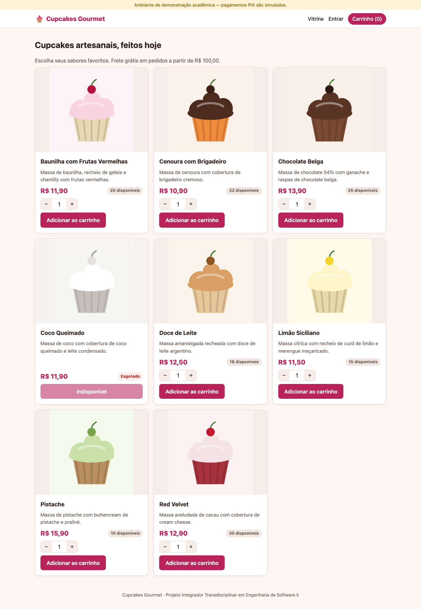
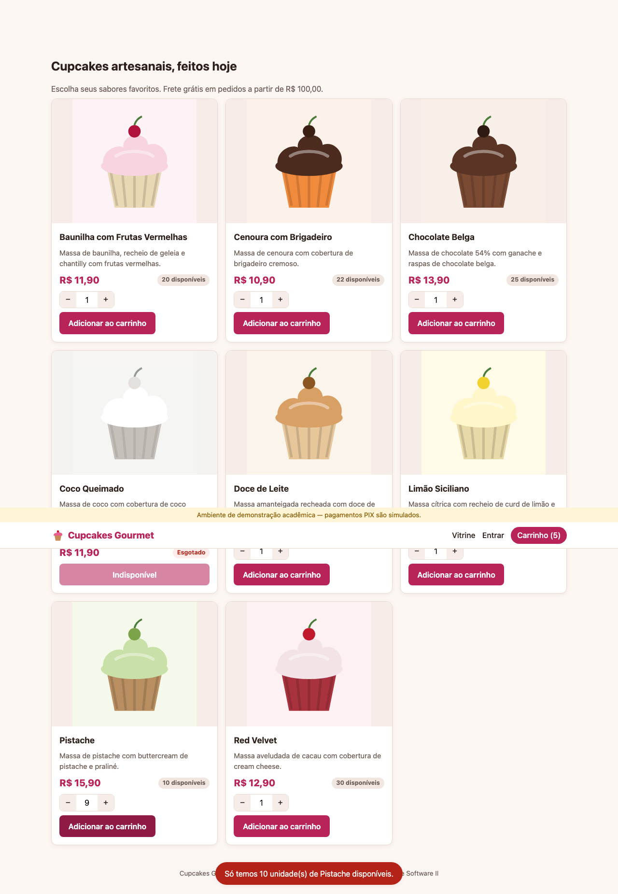
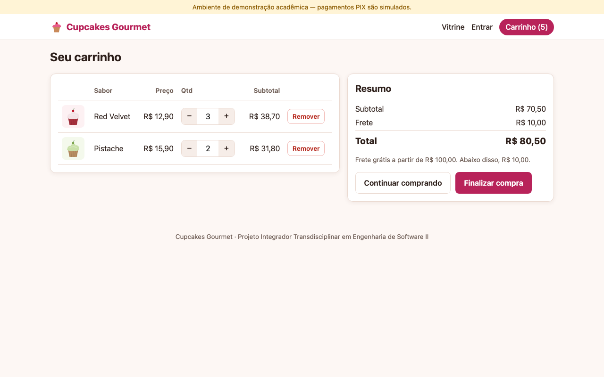
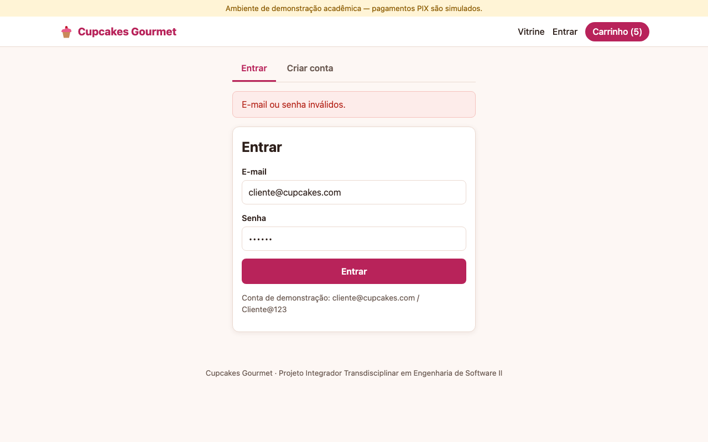
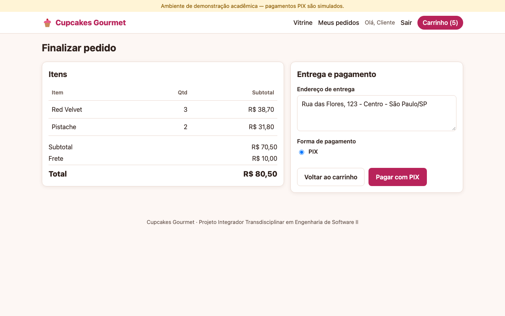
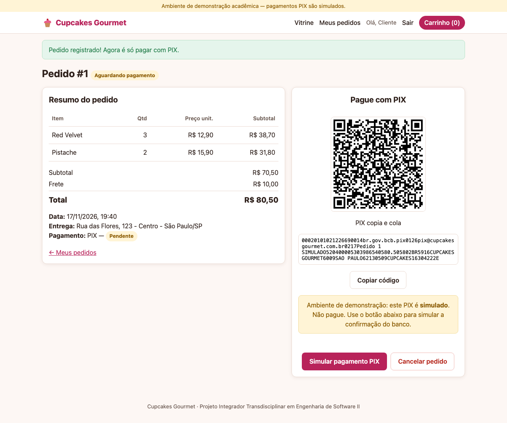
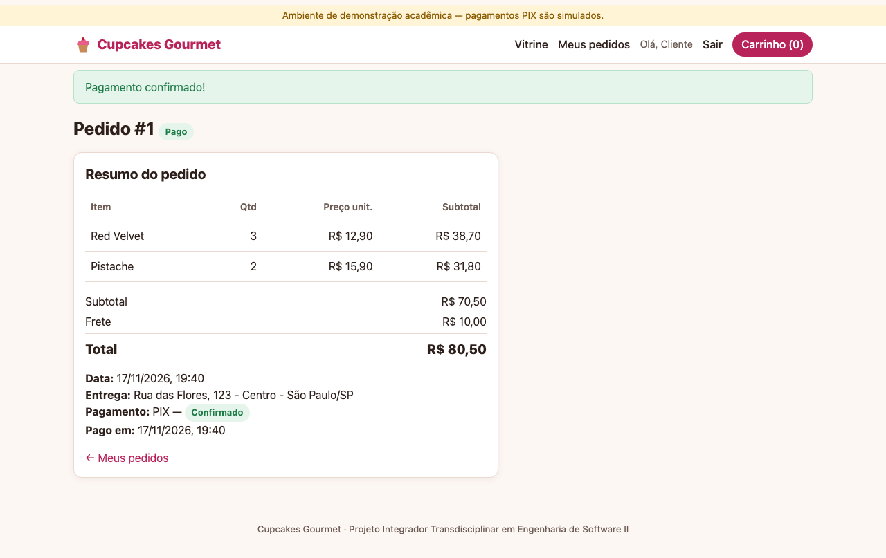
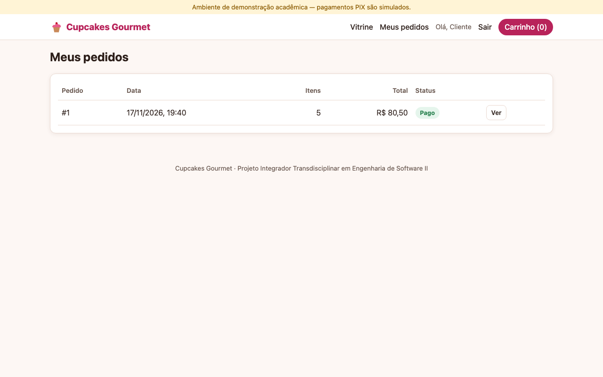
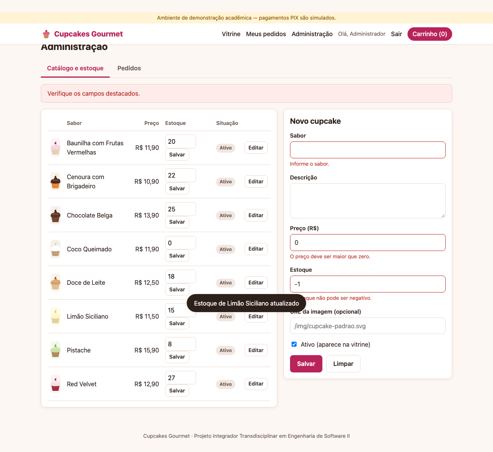
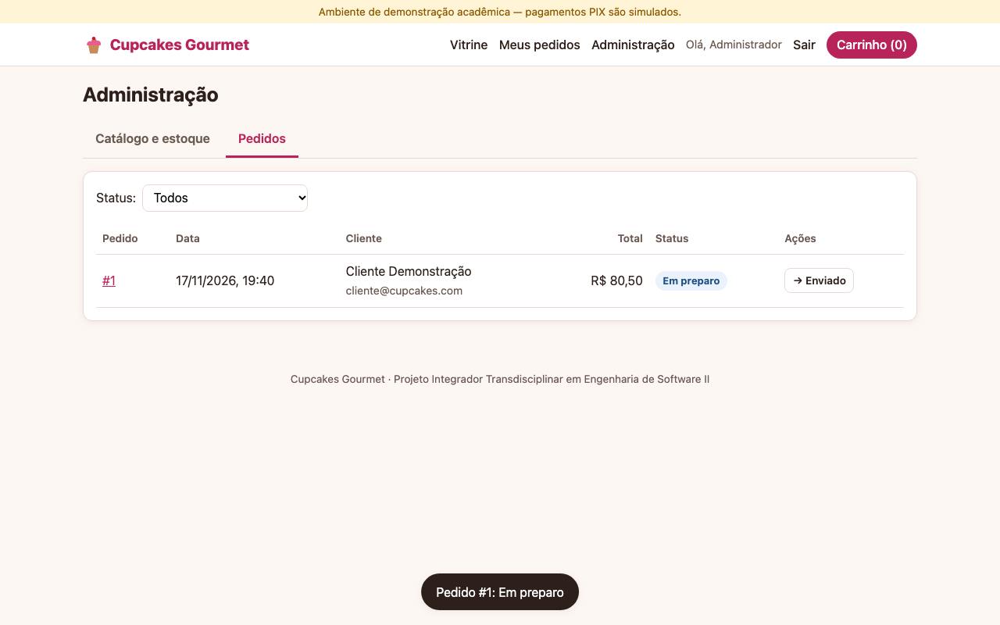

# Manual de Uso — Cupcakes Gourmet

Loja online de cupcakes artesanais. Funciona no navegador do computador e do celular.

> **Ambiente de demonstração.** O pagamento PIX é **simulado**: o código e o QR Code são gerados no formato
> oficial, mas a chave é fictícia. Não pague. Use o botão **"Simular pagamento PIX"**.

**Contas de demonstração**

| Perfil | E-mail | Senha |
|--------|--------|-------|
| Cliente | `cliente@cupcakes.com` | `Cliente@123` |
| Administrador | `admin@cupcakes.com` | `Admin@123` (*no ambiente hospedado pode ter sido trocada — ver documento de entrega*) |

---

## 1. Para o cliente

### 1.1 Ver os cupcakes (Vitrine)
Abra o endereço da loja. A vitrine mostra todos os sabores com foto, descrição, preço e disponibilidade.
Não é preciso entrar na conta para ver os produtos nem para montar o carrinho.

- **"Últimas N unidades"** (amarelo): estoque baixo.
- **"Esgotado"** (vermelho): sem estoque; o botão fica desabilitado.

### 1.2 Adicionar ao carrinho
1. Ajuste a quantidade com **−** e **+**.
2. Clique em **Adicionar ao carrinho**. O contador no topo ("Carrinho (N)") é atualizado.

Se você pedir mais do que temos em estoque, aparece o aviso *"Só temos N unidade(s) de … disponíveis."*
O limite é de 20 unidades por sabor em cada pedido.

### 1.3 Revisar o carrinho
Clique em **Carrinho** no topo. Você pode alterar quantidades e remover itens. O resumo mostra:

- **Subtotal** — soma dos itens;
- **Frete** — **grátis a partir de R$ 100,00**; abaixo disso, **R$ 10,00**;
- **Total**.

### 1.4 Entrar ou criar conta
Ao clicar em **Finalizar compra** sem estar logado, o sistema abre a tela de login e, depois de entrar,
volta automaticamente para o pagamento.

- **Entrar:** e-mail e senha.
- **Criar conta:** nome, e-mail, senha (mínimo 6 caracteres) e, opcionalmente, telefone e endereço.
  O endereço informado já vem preenchido no checkout.

Mensagens possíveis: *"E-mail ou senha inválidos."*, *"Este e-mail já está cadastrado…"*, e erros específicos em
vermelho embaixo de cada campo.

### 1.5 Finalizar o pedido
1. Confira os itens e valores.
2. Confirme ou edite o **endereço de entrega**.
3. Clique em **Pagar com PIX**.

O sistema confere o estoque novamente nesse momento. Se algum cupcake acabou enquanto você comprava, aparece
*"Estoque insuficiente para …: disponível X, solicitado Y."* e nada é cobrado — ajuste o carrinho e tente de novo.

### 1.6 Pagar com PIX
A tela do pedido mostra o **QR Code** e o código **PIX copia e cola** (botão **Copiar código**).

Nesta demonstração, clique em **Simular pagamento PIX**: o pedido passa para **Pago**.
Enquanto o pedido estiver *Aguardando pagamento*, você pode **Cancelar pedido**.

### 1.7 Acompanhar pedidos
Menu **Meus pedidos**: lista com número, data, quantidade de itens, total e status. Clique em **Ver** para o
resumo completo.

| Status | Significado |
|--------|-------------|
| Aguardando pagamento | Pedido registrado, PIX ainda não confirmado |
| Pago | Pagamento confirmado |
| Em preparo | A confeitaria está produzindo |
| Enviado | Saiu para entrega |
| Entregue | Pedido concluído |
| Cancelado | Pedido cancelado; nada é cobrado |

---

## 2. Para o administrador

Entre com a conta de administrador. O menu **Administração** aparece no topo.

### 2.1 Catálogo e estoque
- **Cadastrar:** preencha o formulário à direita (sabor, descrição, preço, estoque, URL da imagem opcional) e
  clique em **Salvar**.
- **Editar:** clique em **Editar** na linha do cupcake; o formulário é preenchido. O campo Estoque fica
  bloqueado na edição — o estoque é alterado só pela tabela (assim uma venda feita enquanto você edita não é desfeita).
- **Ativar/desativar:** marque ou desmarque **Ativo** e salve. Cupcakes inativos somem da vitrine, mas continuam
  nos pedidos antigos (não existe exclusão, para preservar o histórico).
- **Repor estoque:** altere o número na coluna Estoque e clique em **Salvar** na mesma linha.

### 2.2 Pedidos
Na aba **Pedidos**, filtre por status e use os botões da coluna **Ações** para avançar o pedido:
*Aguardando pagamento → Pago → Em preparo → Enviado → Entregue*. **Cancelar** só é possível antes do envio e
devolve os itens ao estoque.

---

## 3. Dúvidas frequentes

**Preciso de conta para ver os produtos?** Não. A conta só é pedida para finalizar a compra.

**O preço mudou depois que comprei. Vou pagar a diferença?** Não. O preço de cada item fica registrado no momento
do pedido.

**Fechei o navegador. Perdi o carrinho?** Não. O carrinho fica salvo no navegador do aparelho.

**Apareceu "Sua sessão expirou".** Recarregue a página e tente novamente.
